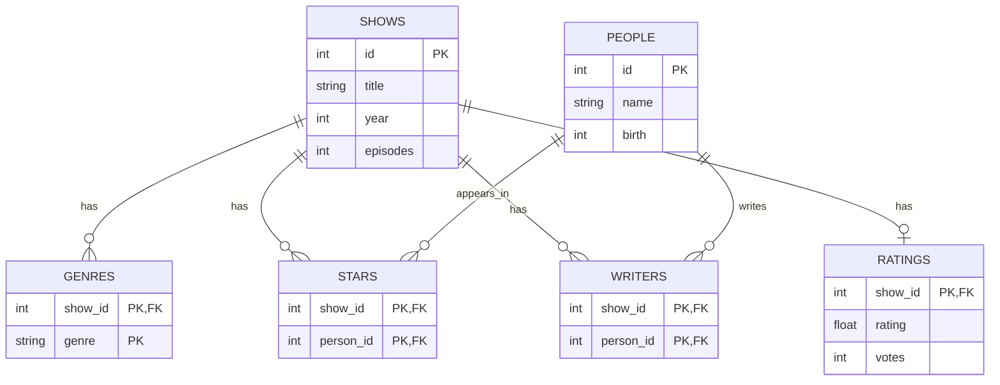

# TV Show Catalog ERD

This is my ERD for a TV show catalog.

## Assumptions

- A show has a title, a release year, and a number of episodes.
- A show can have more than one genre.
- A show can have no actors, especially documentaries.
- One person can be both an actor and a writer.
- A show may not have a rating yet.
- Each show can have at most one overall rating.

## ERD

