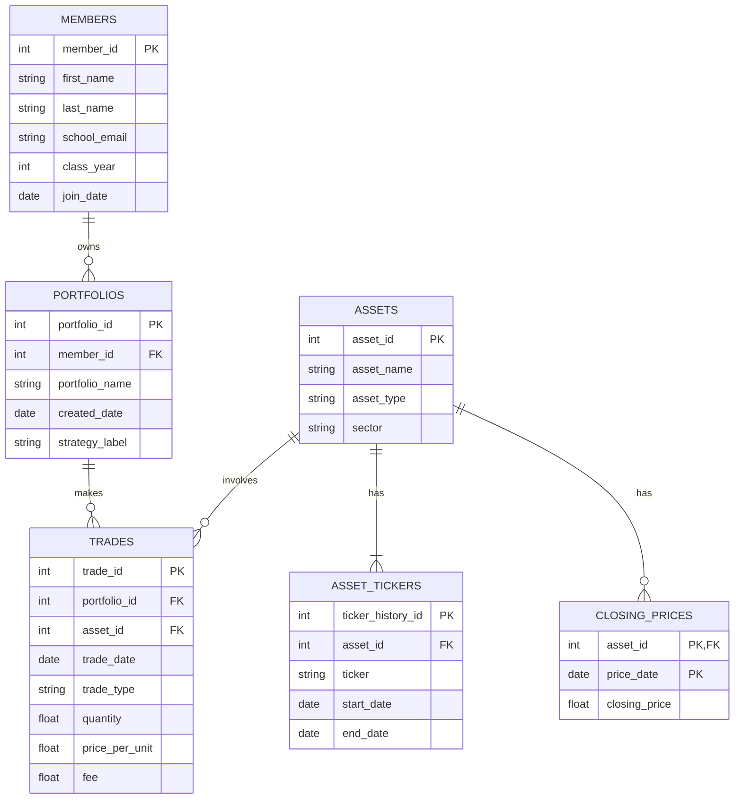

# 1. The Scenario
Scenario B: Babson Investment Club
Babson Investment Club is a student investment club that manages paper portfolios for learning purposes. Currently, the club stores information in spreadsheets and broker screenshots.
The goal is to create a database to organize members, portfolios, assets, trades, and daily closing prices. This will allow the club to track investment activity, calculate portfolio holdings, and understand how portfolio values change over time.

# 2. The ERD

# 3. What One Row Means
1. **MEMBERS:** One row represents one student who belongs to the investment club.
2. **PORTFOLIOS:** One row represents one investment portfolio owned by a member.
3. **ASSETS:** One row represents one financial asset, such as a stock, ETF, or cryptocurrency.
4. **ASSET_TICKERS:** One row represents one ticker used by an asset during a specific period.
5. **TRADES:** One row represents one buy or sell transaction made by a portfolio.
6. **CLOSING_PRICES:** One row represents the closing price of one asset on a specific date.

# 4. Design Choices
**1. Choice of Primary Keys:**
I decided to use `asset_id` instead of the ticker because tickers can change over time. This way, we can still identify the same asset even if its ticker changes.

**2. Optional Relationships:**
Not every member needs to have a portfolio, and some assets may never be traded. Also, some portfolios may not have a strategy, and cryptocurrencies do not have a sector.

**3. Rules That Cannot Be Enforced by the Tables:**
One rule is that a portfolio cannot sell more units than it owns. We cannot check this with a simple constraint because we need to look at previous trades. Instead, I will use a SQL query to check it.

**4. Checking the ERD:**
I checked that a member can have several portfolios, but each portfolio belongs to only one member. I also made sure that every trade is linked to a portfolio and an asset.